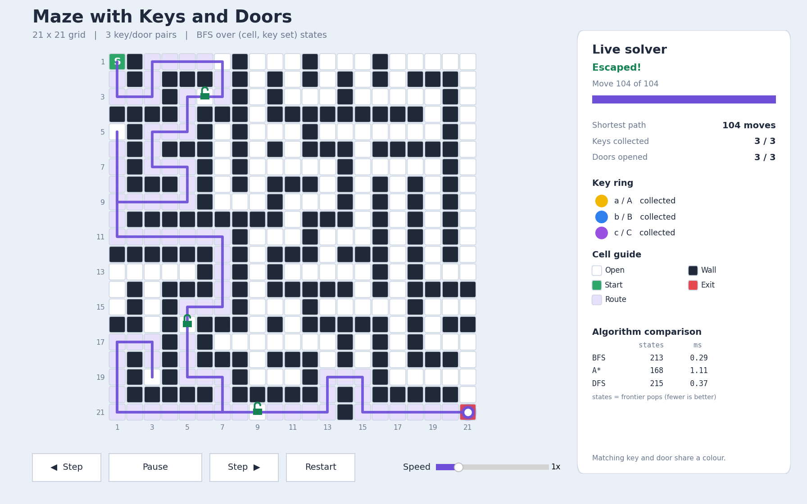

# Maze with Keys and Doors (Problem 1)

Shortest path from `S` to `E` through an N x N grid with walls, keys `a`-`f` and doors `A`-`F`.
Keys are picked up automatically and never used up; a door can be entered only when its key is held.

* **Solver:** Breadth-First Search over `(row, col, key-set)` states, `O(N^2 * 2^T)` (see `ANALYSIS.md` for the proof).
* **Random mazes:** solvable by construction, exactly `T` keys and `T` doors, and the shortest route really needs every key.
* **Visualisation:** interactive Matplotlib window with animated key pick-ups, unlocking padlocks, a live key ring and playback controls.
* **Comparative analysis:** BFS vs A\* vs DFS vs an independent oracle, plus a deliberately wrong "naive" BFS that shows why the key set must be part of the state.



## Quick start

```powershell
py -3 -m venv .venv
.\.venv\Scripts\Activate.ps1          # if blocked: Set-ExecutionPolicy -Scope CurrentUser RemoteSigned
python -m pip install -r requirements.txt
python main.py
```

(macOS / Linux: `python3 -m venv .venv && source .venv/bin/activate`.)

`main.py` follows the problem statement's input format. It reads `T` from standard input, then asks for the source:

```
Enter T (number of key/door types, 1-6): 3
Enter 1 or 2: 2            <- 1 = CSV file, 2 = random solvable maze
Grid size N (Enter = 21):  <- random maze only; press Enter for the default
```

For the CSV option, type the path (or press Enter to use `sample_maze.csv`).
**Standard output contains only the answer** (the shortest path length, or `-1`); prompts, tables and notes go to standard error, so the program can be piped and scripted.

### Command-line shortcuts

| Command | What it does |
|---|---|
| `python main.py --csv samples/sample_t3_generated.csv` | Solve a CSV maze (T is still read from stdin, or add `--types 3`) |
| `python main.py --types 4 --random --size 25 --seed 7` | Reproducible random maze |
| `python main.py --types 2 --random --no-gui` | Headless: just the answer and the CSV files |
| `python main.py ... --gif output/run.gif --png output/final.png` | Export the animation / a final snapshot |
| `python main.py ... --solver astar` | Use A\* (or `dfs`) to produce the route |
| `echo 3 \| python main.py --random --no-gui` | Scripted use, answer on stdout |

## Input format

An N x N CSV, one grid row per line (compact rows such as `S.aA` are also accepted):

```csv
S,a,A,.,.,.,.,.
#,#,#,#,#,#,#,.
...
#,#,#,#,#,#,#,E
```

| Symbol | Meaning |
|---|---|
| `.` | open cell |
| `#` | wall |
| `S` / `E` | start / exit (exactly one `S`) |
| `a`-`f` | key (picked up when you step on it) |
| `A`-`F` | door, passable only with the matching lower-case key |

**The `E` collision.** The statement uses `E` for the exit *and* the door of key `e`. When key `e` is present, the **last `E` in row-major order is the exit** and any earlier `E` is a door. Without key `e` there must be exactly one `E`. The random generator always places the exit last, so its mazes are unambiguous.

Mismatches such as "T = 3 but the grid has 2 key types" or "door `B` has no key" are reported as notes on stderr, not fatal errors (a door whose key does not exist is simply a permanent wall). Structural problems (not square, bad symbol, missing or duplicate `S`/`E`) stop the program with a clear message.

## Output files (written to `output/`)

| File | Content |
|---|---|
| `solution_path.csv` | The maze with the route marked by `x`. `S`, `E`, keys and doors keep their letters, so every pick-up and door opening on the route is still identifiable. |
| `solution_steps.csv` | One line per step: `step,row,col,cell,event,keys_held` (e.g. `Picked up key a`, `Opened door A with key a`). |
| `generated_maze.csv` | The random maze that was generated (reusable as CSV input). |
| `benchmark.csv`, `analysis_benchmark.png` | Written by `analysis.py`. |

## Visualisation

* **Colours:** white open, black wall, green start, red exit. Each key/door pair has its own colour that never clashes with those four (`a` gold, `b` blue, `c` violet, `d` orange, `e` pink, `f` brown). Keys are round badges, doors carry a padlock.
* **Path:** the shortest route is tinted on the board; a purple trail follows the runner.
* **Key pick-up:** the key tile fades to white, its badge shrinks away and the **Key ring** panel marks it collected.
* **Door opening:** the door tile fades from its colour to white while its padlock swings open (green) and moves to the centre.
* **Panel:** move counter and progress bar, keys collected, doors opened, and the algorithm comparison (states expanded and time for BFS / A\* / DFS).
* **No solution:** the maze is shown with the reachable region tinted red.

Controls: **Play/Pause**, **Restart**, **Step back / forward**, **Speed** slider. Keyboard: `Space` play/pause, `Left`/`Right` step, `R` restart.

## Tests and analysis

```powershell
python -m unittest discover -s tests -v    # 30 tests, <1 s
python analysis.py                          # cross-check + benchmark charts (about 5 s); --show opens the window
```

The tests cover shortest routes, revisiting a cell with a different key set, a door guarding its own key, unreachable exits, doors with no key, duplicate keys/doors, chains of doors, the `e`/`E` collision, all six types, parser errors, CSV marking, route replay, the random generator (all T, many seeds) and a 400-case fuzz test that compares four independent algorithms.

## Project layout

```
main.py            command-line program (stdin protocol, CSV outputs)
maze_solver.py     parsing, generator, BFS / A* / DFS / naive / key-graph solvers, CSV writers
visualizer.py      interactive animation, GIF / PNG export
analysis.py        correctness cross-check and benchmarks
ANALYSIS.md        complexity, proof of optimality, corner cases, comparative analysis
samples/           ready-made mazes (revisit, locked key, e/E collision, generated T=3 and T=6)
tests/             unit and fuzz tests
output/            results of the sample run
docs/              screenshots
```

## Requirement checklist

| Requirement from the problem sheet | Where |
|---|---|
| Read T from standard input | `main.py` |
| Option 1: NxN grid from CSV / Option 2: random valid maze with T keys, T doors, solvable | `load_maze`, `generate_maze` |
| Output 1: single integer (or -1) | stdout of `main.py` |
| Output 2: CSV with `x` path, keys and doors identifiable | `output/solution_path.csv` |
| Colour scheme, path highlight, key pick-up and door-opening animation, inventory panel | `visualizer.py` |
| Deep-dive analysis, corner cases, proof of optimality, comparative analysis | `ANALYSIS.md`, `analysis.py`, `tests/` |
