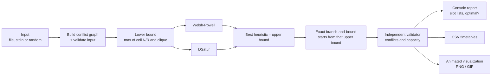
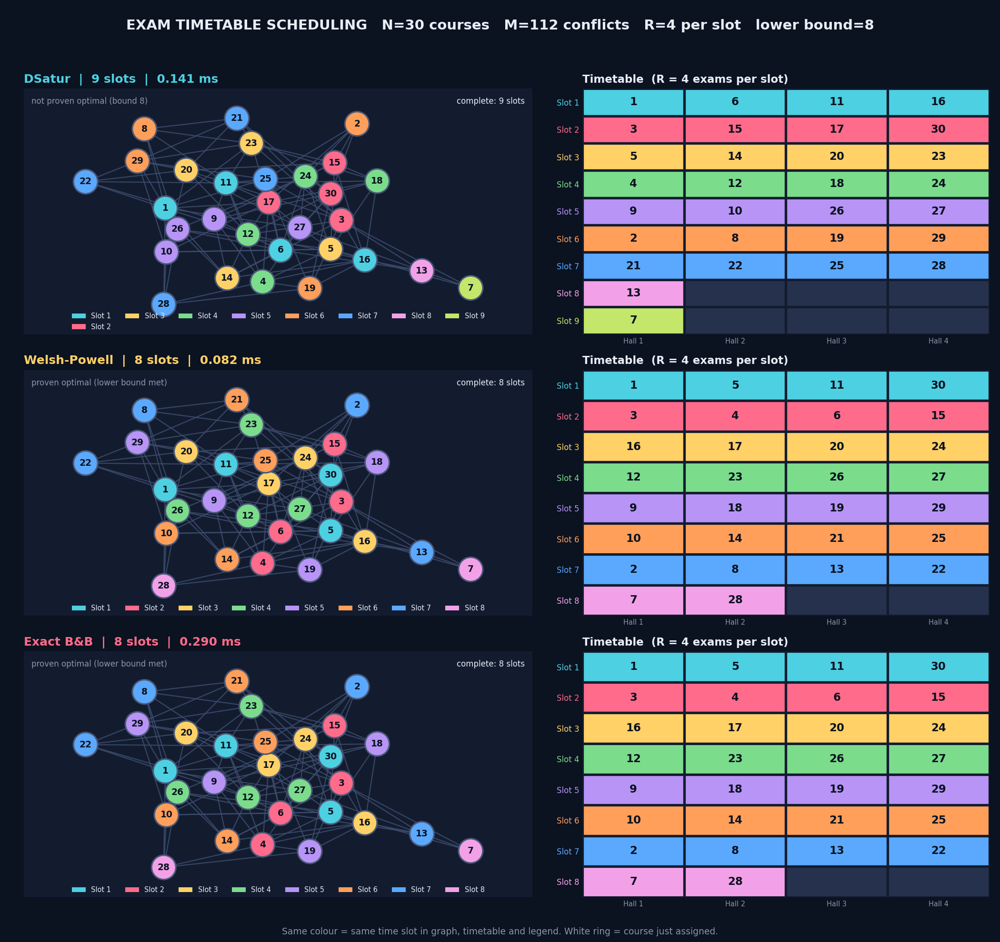
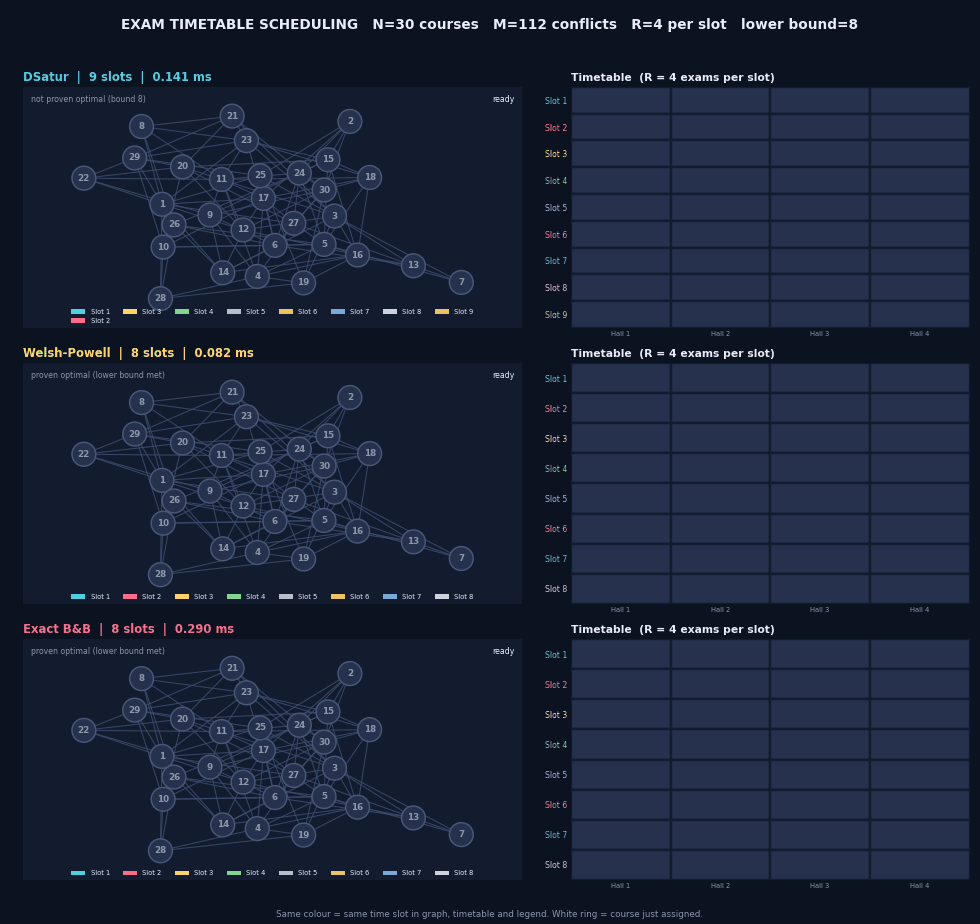
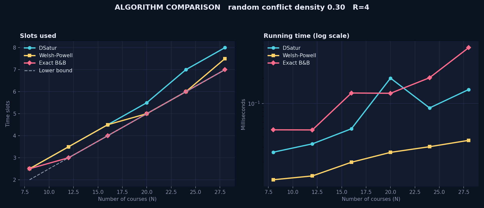

# Exam Timetable Scheduling (Problem 4)

Minimum number of exam slots for N courses with conflicts and at most `R` exams per slot (graph colouring with hall capacity).
CSE Hackathon on Data Structures and Algorithms, Department of CSE, CMRIT, Bangalore.

* **Solvers:** Welsh-Powell and DSatur (greedy heuristics) plus an exact branch-and-bound, `O(S^N * (N + deg))` worst case (see *Time and space complexity*).
* **Optimality:** every result reports whether it is **proven optimal** (lower bound `max(ceil(N/R), clique)` matched, or the exact search finished).
* **Random graphs:** Option 2 generates a conflict graph with your chosen edge density; `--seed` makes runs reproducible.
* **Visualisation:** colour-coded conflict graph and timetable grid for every algorithm, with an animation of the order in which courses are assigned, plus slots and running-time charts as N grows.
* **Comparative analysis:** Welsh-Powell vs DSatur vs exact, a benchmark over increasing N, and 14 tests that check the exact solver against brute force.


## Quick start

```powershell
py -3 -m venv .venv
.\.venv\Scripts\Activate.ps1          # if blocked: Set-ExecutionPolicy -Scope CurrentUser RemoteSigned
python -m pip install -r requirements.txt
python main.py
```

(macOS / Linux: `python3 -m venv .venv && source .venv/bin/activate`.)

`python main.py` opens a menu:

```
1. Load a conflict graph from a file (N M R + edges)
2. Generate a random graph (N R + density)
3. Benchmark all algorithms as N grows
Choose 1, 2, or 3: 2
Enter N R on one line: 30 4
Enter edge density (0.0 to 1.0): 0.25
```

Prompts go to standard error, results to standard output. Close the figure window to return to the terminal.

## Input format

**Option 1** is a text file (or stdin) with `N M R` on the first line, then exactly `M` lines `u v` (1-based course ids). `#` starts a comment.

```text
8 9 3
1 2
1 3
2 3
2 4
3 5
4 5
4 6
5 7
7 8
```

**Option 2** is two lines: `N R`, then the edge density from `0.0` to `1.0`. Every pair of courses conflicts independently with that probability.

```text
30 4
0.25
```

| Situation | Behaviour |
|---|---|
| Duplicate conflict (`1 2` and `2 1`) | merged, not an error |
| Self-conflict, id outside `1..N`, wrong number of lines, empty input, `R < 1`, density outside `0..1` | stops with a clear `Input error` message |
| `R` larger than `N` | allowed; CSV uses at most `N` hall columns |

### Command-line shortcuts

| Command | What it does |
|---|---|
| `python main.py --file sample_graph.txt` | Option 1 from a file |
| `python main.py --stdin-graph` | Option 1 typed or piped through stdin |
| `python main.py --random --seed 7` | Option 2 from stdin (`N R`, then density), reproducible |
| `python main.py --benchmark` | Slots and running time for increasing N |
| `python main.py --file sample_graph.txt --time-limit 30` | Allow the exact search up to 30 s (default 10 s) |
| `python main.py --file sample_graph.txt --gif` | Also save the animation as a GIF |
| `python main.py --file sample_graph.txt --no-show` | Headless: print results and save files only |
| `python main.py --file sample_graph.txt --no-animate` | Show the finished schedules without animating |
| `python main.py --file sample_graph.txt --out results` | Write outputs to `results/` instead of `output/` |

Example scripted run: `printf "30 4\n0.25\n" | python main.py --random --seed 11 --no-show`

## Output files (written to `output/`)

| File | Content |
|---|---|
| `timetable_dsatur.csv`, `timetable_welsh_powell.csv`, `timetable_exact.csv` | Rows = slots, columns = halls (`Hall 1`...), blank cells for unused halls |
| `schedule_comparison.png` | Final conflict graphs and timetable grids for all three algorithms |
| `schedule_animation.gif` | Assignment-order animation (only with `--gif`) |
| `benchmark.csv`, `benchmark.png` | Written by `--benchmark` |

The console also prints the slot count, time and *proven optimal?* for each algorithm, then the slot-wise lists:

```text
Algorithm      Slots   Time (ms)   Proven optimal?
DSatur             3       0.071   yes (lower bound matched)
Welsh-Powell       3       0.026   yes (lower bound matched)
Exact B&B          3       0.040   yes (lower bound matched)

Slot 1: 2, 5, 6
Slot 2: 3, 4, 7
Slot 3: 1, 8
```

Sample CSV (`timetable_exact.csv`, N=30, R=4):

```text
Slot,Hall 1,Hall 2,Hall 3,Hall 4
Slot 1,1,5,11,30
Slot 2,3,4,6,15
Slot 3,16,17,20,24
```

---

## Problem statement

A university has **N courses**. Two courses *conflict* if at least one student is enrolled in both, so they cannot be
scheduled in the same time slot. In addition, **at most R exams** can be held in any single slot (limited number of halls).

Assign every course to a slot so that
* no two conflicting courses share a slot,
* no slot exceeds R exams,
* the **total number of slots is minimised**.

Implement at least one **greedy heuristic** (Welsh-Powell or DSatur) and one **exact method** (backtracking /
branch-and-bound), and **compare** them.

### Input
| Option | Format |
|---|---|
| **1** | First line `N M R`, then `M` lines `u v` (courses `u` and `v` conflict) |
| **2** | First line `N R`, then a user-specified **edge density**; a random conflict graph is generated |

### Output
1. Minimum number of slots **for each algorithm**, and whether the result is **proven optimal**.
2. Slot-wise list of courses, e.g. `Slot 1: 2, 5, 9`.
3. CSV timetable (rows = slots, columns = exam positions / halls).

### Visualization required
* Conflict graph with nodes coloured by assigned slot.
* Final timetable grid using the same colour scheme.
* Comparison chart of slots used and running time for each algorithm as N increases.
* Animation of the order in which courses are assigned (optional).

### Analysis required
Working solution, corner cases, comparative analysis, and a proof/justification of optimality.

---

---

## My solution at a glance

The problem is **graph colouring with a colour-class size limit**:

| Real world | Graph model |
|---|---|
| course | vertex |
| conflict | edge |
| time slot | colour |
| hall capacity R | every colour class has at most R vertices |

I implemented **three algorithms** and a common pipeline around them:

| # | Algorithm | Type | Role |
|---|---|---|---|
| 1 | **Welsh-Powell** | greedy heuristic | very fast baseline |
| 2 | **DSatur** | greedy heuristic | smarter ordering, fast |
| 3 | **Exact Branch-and-Bound** | exact (anytime) | finds / proves the minimum |



The heuristics give a good timetable in microseconds. The exact solver starts from the better of them as its upper bound
and only searches for something *strictly better*, so it is both fast on easy instances and able to **prove** optimality.

---

---

## Algorithm logic

### Lower bound (used to prove optimality)
```
LB = max( ceil(N / R),  ω )
   ceil(N/R) : each slot holds <= R exams
   ω         : size of a clique found greedily; clique members pairwise conflict -> one slot each
```
Any timetable with exactly `LB` slots is **provably optimal**.

### Welsh-Powell
```
sort courses by degree, highest first
slot = 0
while courses remain:
    members = []
    for course in remaining (in sorted order):
        if |members| < R and course conflicts with nobody in members:
            members.append(course)
    put all members into `slot`;  remove them;  slot += 1
```
*Idea:* high-degree courses are the hardest to place, so place them first and pack each slot completely.

### DSatur (Degree of Saturation)
```
saturation[v] = number of DIFFERENT slots already used by neighbours of v
repeat N times:
    v = unassigned course with the highest saturation (ties: higher degree, then lower id)
    put v in the first existing slot that has a free seat and no conflicting neighbour
    if none exists: open a new slot
    update saturation of v's neighbours
```
*Idea:* the course with the fewest remaining legal slots is the most constrained, so schedule it now.

### Exact branch-and-bound
```
search(used):                              # `used` = slots opened so far
    if all courses assigned:  record if used < best; stop early if best == LB
    if used >= best:                                   return   # prune 1: cannot improve
    free = used*R - assigned
    if used + ceil(max(0, left - free) / R) >= best:   return   # prune 2: not enough seats
    v = unassigned course with max (saturation, degree)         # DSatur ordering = fail-first
    for slot in existing slots (fuller first):
        if slot has a seat and no conflicting neighbour:  place v, search(used), undo
    if used + 1 < best:
        open exactly ONE new slot for v, search(used+1), undo  # prune 3: symmetry removal
```
Starting `best` = the heuristic result, so the search only looks for better timetables.
It is **anytime**: if the time limit is hit, the best timetable found so far is returned and marked *not proven optimal*.

### Independent validator
After every algorithm, `validate()` re-checks the final timetable from scratch: every course assigned, no conflicting
pair in the same slot, no slot above R, slots numbered contiguously. A faulty algorithm cannot silently print a wrong answer.

### Worked example (`sample_graph.txt`: N=8, M=9, R=3)
```
Conflicts: 1-2 1-3 2-3 2-4 3-5 4-5 4-6 5-7 7-8
Lower bound: ceil(8/3)=3 and clique {1,2,3} = 3   ->  LB = 3
```
| Slot | Courses |
|---|---|
| Slot 1 | 2, 5, 6 |
| Slot 2 | 3, 4, 7 |
| Slot 3 | 1, 8 |

All three algorithms reach 3 slots = LB, so all are **proven optimal**.

---

---

## Why this solution (justification and proof)

**Why a heuristic *and* an exact method?** Minimum colouring is NP-hard, and the capacity limit R only makes it harder
(with R ≥ N it is exactly classic graph colouring). A heuristic alone is fast but cannot say how far from optimal it is.
An exact search alone can be too slow for large N. Combining them gives speed *and* certainty.

**Why DSatur and Welsh-Powell?** Both are classic, run in polynomial time, and are cheap to compute. DSatur adapts to the
graph while it colours (saturation is dynamic); Welsh-Powell uses a static degree order and packs slots one at a time.
Neither is guaranteed to beat the other on every graph, so reporting both is a real comparison.

**Why DSatur ordering inside branch-and-bound?** Choosing the most constrained course first (“fail-first”) exposes
dead ends early, which cuts the search tree dramatically compared with a fixed order.

**Proof sketch that the exact solver is optimal**
1. *Completeness.* At each node the solver tries every legal existing slot for the chosen course, plus one new slot.
   Opening a second new slot would give an isomorphic assignment (slot labels are interchangeable), so no distinct
   solution is lost. Hence every distinct feasible timetable is reachable.
2. *Safe pruning.* `used >= best`: the current branch can never beat the incumbent. `used + ceil(max(0,left-free)/R) >= best`:
   after filling all `free` open seats, the remaining courses still need that many *additional* slots, so the branch
   cannot beat the incumbent. Neither rule discards a better solution.
3. *Termination.* The recursion depth is N and each node places one course, so the search ends. If it ends without the time
   limit, no better timetable exists → the incumbent is optimal. It can also stop earlier when `best == LB`, because no
   timetable can use fewer than LB slots.

**Evidence, not just argument:** `tests.py` compares the exact solver with an exhaustive brute-force search on 150 random
small graphs; they always agree, and always satisfy `LB ≤ optimum ≤ heuristic`.

---

---

## Time and space complexity

Notation: **N** courses, **M** conflicts, **R** hall capacity, **S** slots used, **Δ** maximum degree.

| Component | Time | Space | Notes |
|---|---|---|---|
| Parse input / build graph | O(N + M) | O(N + M) | random generation is O(N²) (one coin flip per pair) |
| **Welsh-Powell** | O(N log N + S·N·R) | O(N + M) | sort once, then S passes over the remaining courses, each checking ≤ R members |
| **DSatur** | O(N² + M) | O(N + M) | N rounds × O(N) to find the max-saturation course, plus O(Δ) neighbour updates and an O(S) slot scan |
| Lower bound (greedy clique) | O(N²·ω) | O(N) | tries each start course (capped at the 100 highest-degree for N > 200) |
| **Exact branch-and-bound** | **O(S^N · (N + Δ))** worst case | O(N + M) + recursion depth N | exponential, as expected for an NP-hard problem; per node O(N) to pick a course + O(Δ) to update |
| Validator | O(N + M) | O(N) | |
| CSV export | O(N + S·R) | O(N) | |
| Visualization | O(N²) layout + O(frames · N) | O(N + M) | frames capped at ≈ 90 so large graphs still animate |

**Practical behaviour of the exact solver.** The worst case is exponential, but the lower bound, capacity pruning and
symmetry removal make it finish in well under a millisecond to a few milliseconds on the benchmark sizes below. It
never blocks: the `--time-limit` option always returns a valid timetable.

**Trade-off summary**

| | Welsh-Powell | DSatur | Exact B&B |
|---|---|---|---|
| Speed | fastest | very fast | slowest (worst case exponential) |
| Quality | good | usually better than WP, not always | optimal |
| Proof of optimality | only if it meets LB | only if it meets LB | yes, when the search finishes |

---

---

## Visualizations

### Conflict graph + timetable (one row per algorithm)
Nodes are coloured by assigned slot; the timetable grid on the right uses **the same colours** (rows = slots,
columns = halls). Example: N=30, R=4, density 0.25.



### Animation of the assignment order
Courses light up in the order the algorithm assigned them (white ring = course just placed) and the matching cell in
the timetable fills at the same moment. Save it with `--gif`.



### Slots and running time as N grows
Left: slots used by each algorithm versus the lower bound. Right: running time on a log scale
(a white ✕ would mark graphs where the exact solver hit its time limit).



---

---

## Results and comparative analysis

### Single instance (N=30, M=112, R=4, seed 11)
| Algorithm | Slots | Time | Proven optimal? |
|---|---|---|---|
| DSatur | 9 | ≈ 0.14 ms | no (1 above the lower bound of 8) |
| Welsh-Powell | 8 | ≈ 0.04 ms | yes (lower bound matched) |
| Exact B&B | 8 | ≈ 0.3 ms | yes (lower bound matched) |

### Benchmark: R=4, density 0.3, average of 2 random graphs per size
| N | Lower bound | DSatur | Welsh-Powell | Exact | DSatur ms | W-P ms | Exact ms |
|---|---|---|---|---|---|---|---|
| 8 | 2.0 | 2.5 | 2.5 | 2.5 | 0.026 | 0.012 | 0.048 |
| 12 | 3.0 | 3.5 | 3.5 | **3.0** | 0.033 | 0.014 | 0.048 |
| 16 | 4.0 | 4.5 | 4.5 | **4.0** | 0.050 | 0.020 | 0.133 |
| 20 | 5.0 | 5.5 | 5.0 | 5.0 | 0.200 | 0.026 | 0.132 |
| 24 | 6.0 | 7.0 | 6.0 | 6.0 | 0.088 | 0.030 | 0.203 |
| 28 | 7.0 | 8.0 | 7.5 | **7.0** | 0.146 | 0.036 | 0.464 |

**Observations**
* The exact solver always matches the lower bound here, so those results are proven optimal.
* Heuristics are up to one slot worse (N=28: DSatur 8, Welsh-Powell 7.5, exact 7).
* In this benchmark Welsh-Powell was never worse than DSatur (and was better at N=20, 24, 28). Neither heuristic is guaranteed
  to win on every graph, so the exact solver is seeded with the **better** of the two as cheap insurance.
* The price of optimality is small: roughly 3–10× the heuristic time, still under 0.5 ms.
* Times are machine-dependent; the slot counts are reproducible (fixed seeds).

---

---

## Corner cases and testing

| Case | Expected result |
|---|---|
| N = 1 | 1 slot |
| No conflicts, R = 1 | N slots (capacity binds) |
| No conflicts, R ≥ N | 1 slot |
| Complete graph K5 | 5 slots (conflicts bind) |
| Even cycle C6, R = 2 / R = 3 | 3 slots (capacity binds) / 2 slots |
| Odd cycle C5 | 3 slots |
| Star graph, disconnected graph | 2 slots |
| Duplicate conflict lines (`1 2` and `2 1`) | merged, not an error |
| Self-conflict, ID out of range, wrong M, empty input, density > 1, R < 1 | rejected with a clear message |
| Exact solver exceeds `--time-limit` | best valid timetable returned, reported as *not proven optimal* |
| Huge R (R > N) | CSV has at most N hall columns |

Run the 14 automated tests with `python tests.py` (under 1 s). They also compare the exact solver with exhaustive brute force on 150 random small graphs (`LB <= optimum <= heuristics`).

---

---

## Project layout

```
main.py            command-line program: menu, file / stdin / random input, benchmark, reporting
graph_input.py     input parsing and validation, random generator, CSV export
scheduler.py       Welsh-Powell, DSatur, lower bound, exact branch-and-bound, validator
visualization.py   animated graph + timetable figure, benchmark charts
tests.py           corner-case and brute-force tests
sample_graph.txt   sample Option 1 input
requirements.txt   matplotlib, networkx, numpy
docs/              preview image used at the top of this README
sample_output/     example PNG, GIF and CSV files used in the Visualizations section
```

## Requirement checklist

| Requirement from the problem sheet | Where |
|---|---|
| Option 1: `N M R` + conflict lines | `parse_edge_list`, `--file`, `--stdin-graph` |
| Option 2: `N R` + user-specified edge density | `generate_random_graph`, `--random` |
| Greedy heuristic (Welsh-Powell / DSatur) and exact method (branch-and-bound), compared | `scheduler.py`, console table, `--benchmark` |
| Output 1: minimum slots per algorithm and whether proven optimal | console table |
| Output 2: slot-wise list of courses | console output |
| Output 3: CSV timetable (rows = slots, columns = halls) | `output/timetable_*.csv` |
| Conflict graph coloured by slot, timetable grid in the same colours | `schedule_comparison.png`, live window |
| Chart of slots and running time as N increases | `benchmark.png` |
| Animation of assignment order (optional) | live window, `--gif` |
| Corner cases, comparative analysis, proof of optimality | *Corner cases and testing*, *Results*, *Why this solution* |